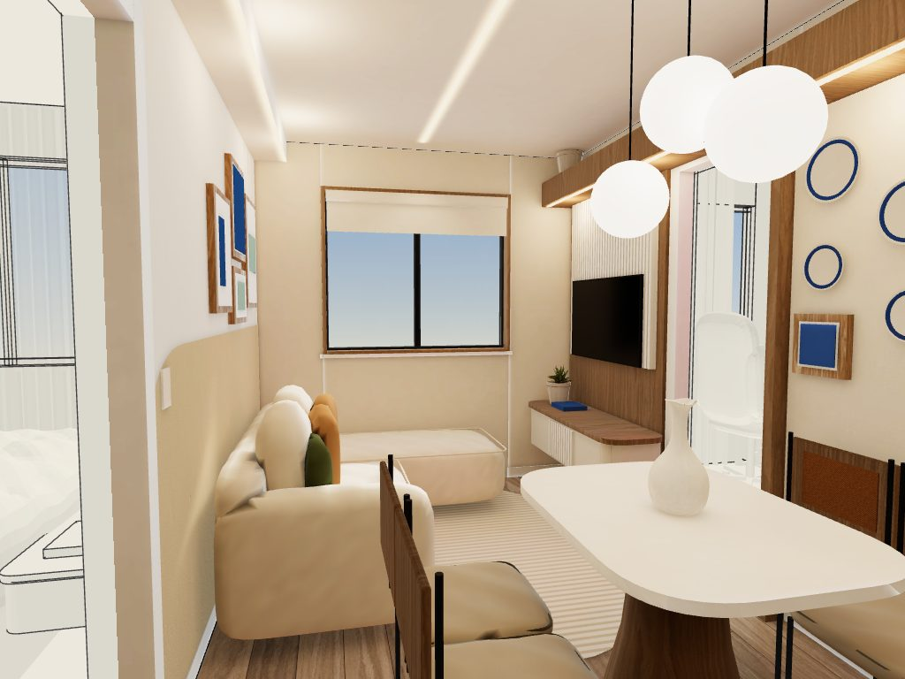
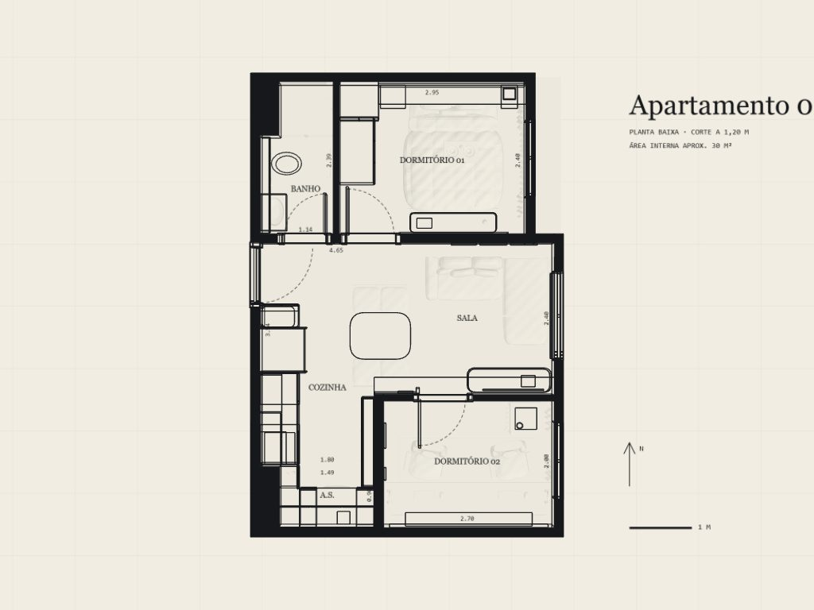
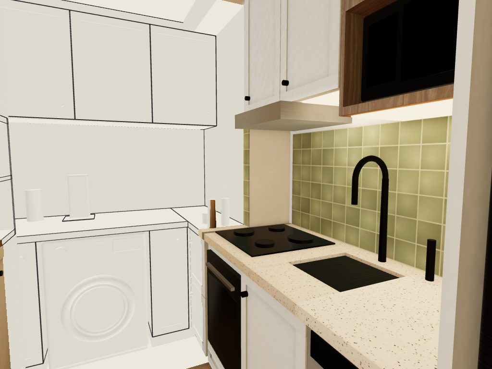
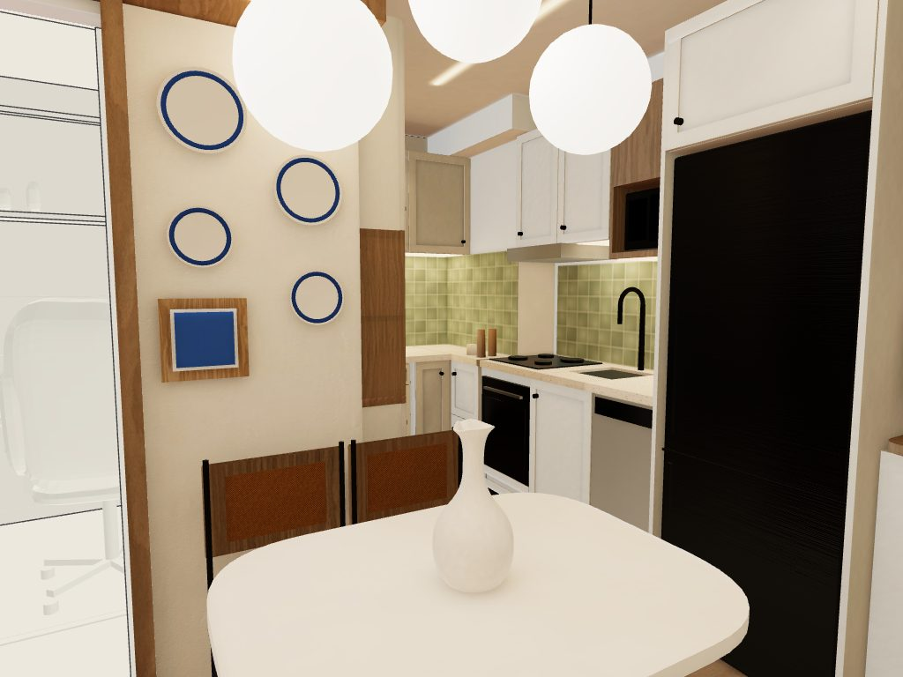
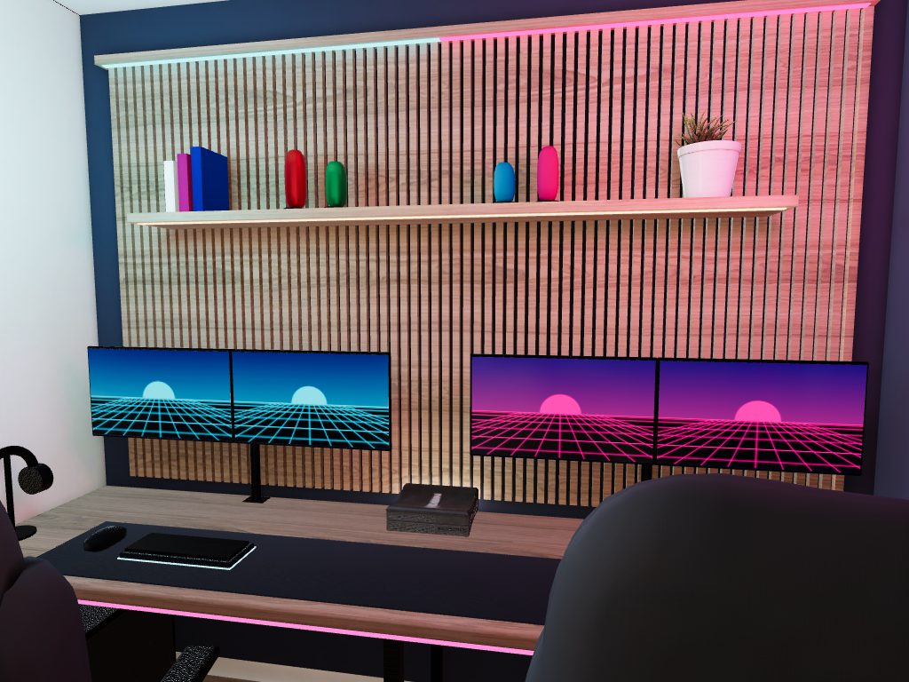
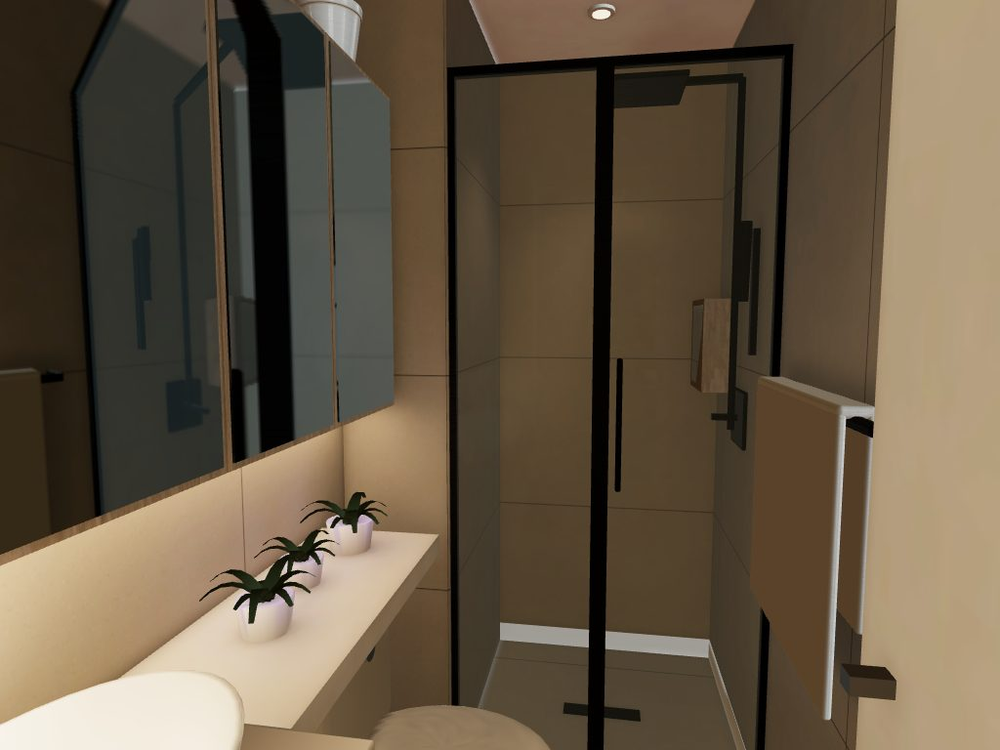
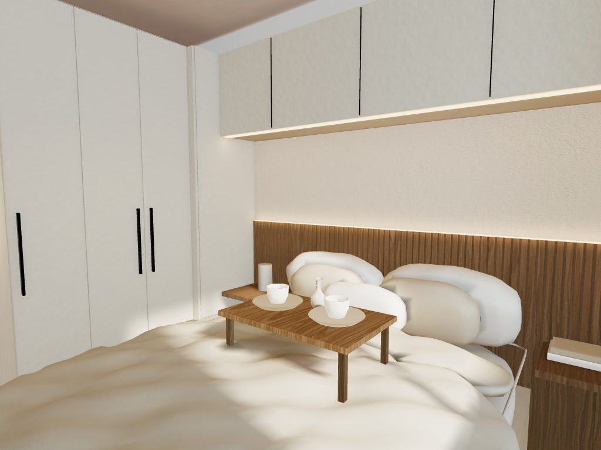
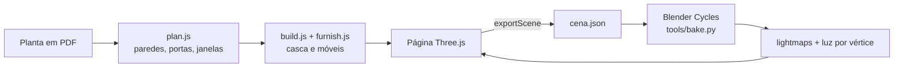

# Apartamento 3D

Passeio 3D por um apartamento de 30 m², conduzido pela rolagem da página. A página abre na planta baixa em papel, as paredes sobem do desenho e a câmera percorre sala, cozinha, área de serviço, quarto gamer, banheiro e dormitório, cômodo por cômodo.

**[Ver o passeio ao vivo →](https://apartamento-3d.vercel.app)**



## Resumo

- **Planta real.** Paredes, portas, janelas, shafts e forro de gesso vêm das coordenadas vetoriais do PDF da planta (escala de 111,9 px por metro). Nada foi desenhado a olho.
- **Móveis escritos em código.** Marcenaria, estofados, eletrodomésticos e decoração são geometria procedural em Three.js, com medidas reais: bancada a 90 cm, mesa a 76 cm, assento do sofá a 44 cm, cama a 61 cm.
- **Luz calculada no Blender.** A iluminação é renderizada no Blender Cycles (4096 px, 512 amostras) em quatro versões: dia e noite, com e sem móveis. Superfícies planas usam um atlas de lightmap; peças curvas recebem luz por vértice.
- **Reflexos por cômodo.** Cada cômodo captura uma imagem 360° de si mesmo depois que a luz é aplicada. Espelho, vidro, metais, geladeira, pedra e azulejo refletem o próprio cômodo, com projeção na caixa do ambiente.
- **Rolagem com GSAP.** ScrollSmoother suaviza a rolagem e ScrollTrigger conduz a câmera por 24 paradas. As viradas usam interpolação de ângulos, então a câmera nunca gira de forma brusca.
- **Leve.** Cerca de 17 MB no total, com texturas de 1024 px e luz por vértice compactada em gzip.

## Galeria

| | |
|---|---|
|  |  |
| Planta baixa, corte a 1,20 m | Cozinha com zellige verde e pedra de terrazzo |
|  |  |
| Mesa para quatro e painel de pratos | Quarto gamer para duas pessoas, com frigobar |
|  |  |
| Armário espelhado, box e samambaias | Guarda-roupa ligado aos aéreos e cabeceira ripada |

## Como funciona



1. `site/src/plan.js` guarda a geometria medida no PDF.
2. `site/src/build.js` monta paredes, portas, forros e esquadrias; `site/src/furnish.js` monta os móveis.
3. A própria página calcula as coordenadas do atlas de luz (`lightmapuv.js`) e exporta a cena para o Blender.
4. `tools/bake.py` renderiza a luz das quatro versões; `tools/pack_lightmaps.py` converte o resultado para a web.
5. `site/src/main.js` aplica a luz, captura os reflexos de cada cômodo e conduz a câmera pela rolagem.

## Rodar localmente

Requer Python 3. Não há etapa de build: o site é estático.

```bash
python tools/serve.py 8770
```

Depois abra http://localhost:8770.

### Refazer a luz (opcional)

Requer o Blender 5.x com GPU. Com a página aberta, exporte a cena e rode o bake:

```bash
python tools/receive_scene.py bake/scene.json
```

No console do navegador:

```js
await tour.exportScene('http://127.0.0.1:8771/')
```

```bash
blender --background --factory-startup --python tools/bake.py -- bake/scene.json bake/out 4096 512
```

```bash
python tools/pack_lightmaps.py bake/out site/bake
```

Use `2048 200` no lugar de `4096 512` para uma prévia em cerca de 90 segundos.

## Estrutura

```
site/            site estático publicado
  index.html     página, estilos e interface
  src/           código do passeio (Three.js)
  bake/          luz pré-calculada (lightmaps e luz por vértice)
  textures/      texturas PBR do Poly Haven, reduzidas para a web
  m/             modelos 3D do Poly Haven (vasos, planta, console)
  vendor/        Three.js e GSAP
tools/           servidor local, bake no Blender e utilitários de textura
docs/images/     imagens do README
```

## Tecnologias

- [Three.js](https://threejs.org) r170: cena, materiais PBR, pós-processamento
- [GSAP](https://gsap.com) 3 com ScrollTrigger e ScrollSmoother: rolagem e câmera
- [Blender](https://www.blender.org) Cycles: luz pré-calculada
- [Poly Haven](https://polyhaven.com): texturas, HDRI e modelos (CC0)

## Créditos e licenças

- Código deste repositório: [MIT](LICENSE).
- Three.js: MIT.
- GSAP: [licença padrão da GreenSock](https://gsap.com/standard-license), gratuita.
- Texturas, HDRI e modelos do Poly Haven: CC0.
- Inspirado no projeto [Lintel](https://sam1983aing.github.io/lintel-live/), de Sam1983Aing. Nenhum código dele foi copiado.

Medidas de pé-direito, janelas, móveis e materiais são simulação; o que vem da planta são as paredes, portas e janelas.
